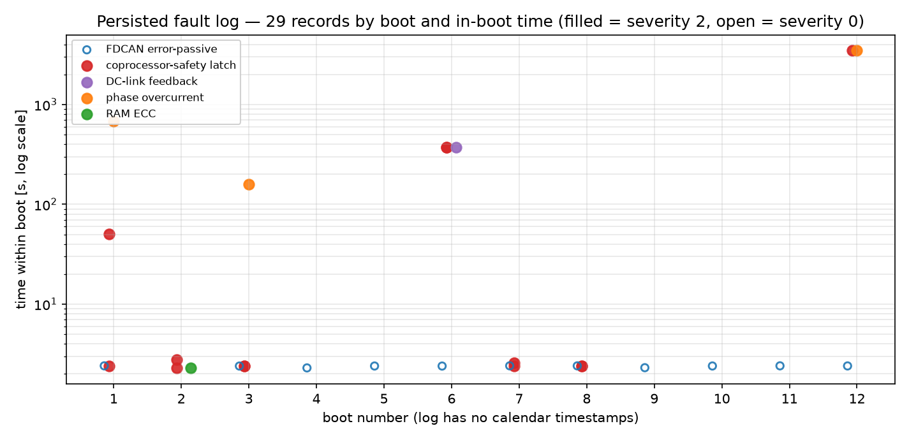

# Gen7 Persisted Fault Log Download and Audit

After the two Zero DSR road rides ([test 11](../Zero-DSR-Road-Test/Index.md), [test 12](../Zero-DSR-Road-Test-2/Index.md)) the Gen7 control board was noticed to be accumulating faults that neither the live telemetry stream nor the console surfaces after the fact. This test is the first deliberate download of the board's **persisted in-memory fault log**: an RTE Android session (TLM1, live mode) connected to the stationary vehicle, during which the board replays its retained fault records over the `fault_log_record` signal, reports the newest entry on `fault_log_latest`, and advertises the retained count on `fault_log_count`. The download session is recording 4 of a set of four captured the same morning (2026-10-19); an independent structural review of all four, with a firmware code-path trace of the overcurrent detector, arrived after the first version of this report and is summarized in *Independent validation bundle (2026-10-19)* below — among other things it ties the log's newest records to a live overcurrent trip captured in recording 3.

**Summary: 29 persisted records covering 12 boots; three recurring failure modes (FDCAN error-passive at startup, coprocessor-safety latch records, software phase overcurrent) plus two one-off records (RAM ECC status IRQ, DC-link current feedback declared invalid). Nothing new was latched during the 103 s diagnostic connect itself, and no fault was live while connected.**

All numbers below are recomputed from the raw session export by `parse_fault_log.py` in this folder, which streams the zstd-compressed capture and decodes every record field structurally; fields whose semantics are not documented are printed raw and left labelled *unknown* rather than given an invented meaning.

## Test article and setup

- **Vehicle / test article:** identical to tests 11/12 — Zero DSR (MY2018), stock Z-Force motor, Gen7 control board on the vehicle harness, stationary (kickstand, no ride).
- **Logging:** RTE Android over USB, protocol TLM1, live mode, port "Control Board Gen 7". Session export `raw/runtime-session-2026-10-19T10-56-50.375Z-17521eb9.jsonl.zst` in `Data/Tests/INT-Gen7-Fault-Log-Audit/raw/` (48.5 MB decompressed, zstd-compressed); 102.7 s live window, full signal set.
- **Board state at connect:** motor control was already RUNNING when the session opened (`control_state` RUNNING from t = 1.34 s, board armed / gate power on), the motor was idle throughout (display rpm within −1.8 … +16.5 rpm, torque current within −3.4 … +2.7 A — sensor noise, no commutation).

## Session integrity

The export's `session_end` statistics report **21 608 good frames**, 1 `reject_header`, 0 CRC/length/payload rejects, and **4 260 `reject_unknown_id`** frames. The unknown-ID rejects are an evolving-protocol edge (the app meeting frame IDs newer than its decoder), not corruption of the stored evidence; they are logged as a follow-up below.

## The persisted log: 29 records across 12 boots

During the connect the board streamed the log as `fault_log_record` state lines. Each of the 29 unique sequence numbers was replayed 14–15 times (410 state samples in total — the board periodically re-streams the whole log, which is exactly what a passive diagnostic download needs); `fault_log_count` held at 29 in all 102 samples, and `fault_log_latest` pointed at the newest record (seq 29). The table lists one row per unique record; `boot ms` is the board millisecond clock within that boot, so records near 2 300–2 400 ms are startup-phase events.

| Seq | Boot | Boot ms | Sev | Source | Reason | Key fields |
|-----|------|---------|-----|------------------------|----------------------|---------------------------------------------------------|
| 1 | 1 | 2408 | 0 | CanErrorPassive | FDCAN error-passive | psr=0000077B ecr=00100080 |
| 2 | 1 | 2403 | 2 | CoprocessorSafety | coprocessor safety fault latched | kind 12, generation 0x3, age 51 ms, trip reason/inputs = invalid (0xFF…) |
| 3 | 1 | 50370 | 2 | CoprocessorSafety | coprocessor safety fault latched | kind 17, generation 0x3, age 208 ms, reason 0x4, inputs 0x9 |
| 4 | 1 | 676587 | 2 | PhaseOvercurrent | software overcurrent | iu 2218.97 A, iv −1114.08 A, iw −1104.89 A, iq −2807.99 A, id −627.60 A, limit 1100 A |
| 5 | 2 | 2282 | 2 | RamEcc | RAM ECC status or IRQ | monitor 9, sr 2, far 0, fdrl EA62C0B2, fecr 0x60 (bit semantics unknown) |
| 6 | 2 | 2291 | 2 | CoprocessorSafety | coprocessor safety fault latched | kind 12, generation 0x3, age 50 ms, trip reason/inputs invalid |
| 7 | 2 | 2785 | 2 | CoprocessorSafety | coprocessor safety fault latched | kind 17, generation 0x3, age 38 ms, reason 0x4, inputs 0x9 |
| 8 | 3 | 2397 | 0 | CanErrorPassive | FDCAN error-passive | psr=0000077B ecr=00100080 |
| 9 | 3 | 2394 | 2 | CoprocessorSafety | coprocessor safety fault latched | kind 12, generation 0x3, age 50 ms, trip reason/inputs invalid |
| 10 | 3 | 2394 | 2 | CoprocessorSafety | coprocessor safety fault latched | kind 17, generation 0x3, age 326 ms, reason 0x4, inputs 0x9 |
| 11 | 3 | 158006 | 2 | PhaseOvercurrent | software overcurrent | iu 2281.60 A, iv −1144.19 A, iw −1137.42 A, iq −2848.31 A, id −782.00 A, limit 1100 A |
| 12 | 4 | 2296 | 0 | CanErrorPassive | FDCAN error-passive | psr=0000077B ecr=00100080 |
| 13 | 5 | 2399 | 0 | CanErrorPassive | FDCAN error-passive | psr=0000077B ecr=00100080 |
| 14 | 6 | 2396 | 0 | CanErrorPassive | FDCAN error-passive | psr=0000077B ecr=00100080 |
| 15 | 6 | 370559 | 2 | DcLinkCurrentFeedback | DC-link current uncalibrated, invalid or stale | current −0.487 A, age 4 ms, calibrated=1, valid=0, iq −0.422 A, iq request 0 |
| 16 | 6 | 370565 | 2 | CoprocessorSafety | coprocessor safety fault latched | kind 12, generation 0x9, age 50 ms, trip reason/inputs invalid |
| 17 | 6 | 370565 | 2 | CoprocessorSafety | coprocessor safety fault latched | kind 17, generation 0x9, age 76 ms, reason 0x4, inputs 0x8 |
| 18 | 7 | 2409 | 0 | CanErrorPassive | FDCAN error-passive | psr=0000076B ecr=00100080 |
| 19 | 7 | 2405 | 2 | CoprocessorSafety | coprocessor safety fault latched | kind 12, generation 0x9, age 50 ms, trip reason/inputs invalid |
| 20 | 7 | 2591 | 2 | CoprocessorSafety | coprocessor safety fault latched | kind 17, generation 0x9, age 151 ms, reason 0x4, inputs 0x8 |
| 21 | 8 | 2407 | 0 | CanErrorPassive | FDCAN error-passive | psr=0000077B ecr=00100080 |
| 22 | 8 | 2407 | 2 | CoprocessorSafety | coprocessor safety fault latched | kind 12, generation 0x9, age 50 ms, trip reason/inputs invalid |
| 23 | 8 | 2407 | 2 | CoprocessorSafety | coprocessor safety fault latched | kind 17, generation 0x9, age 321 ms, reason 0x4, inputs 0x8 |
| 24 | 9 | 2307 | 0 | CanErrorPassive | FDCAN error-passive | psr=0000077B ecr=00100080 |
| 25 | 10 | 2400 | 0 | CanErrorPassive | FDCAN error-passive | psr=0000077B ecr=00100080 |
| 26 | 11 | 2408 | 0 | CanErrorPassive | FDCAN error-passive | psr=0000077B ecr=00100080 |
| 27 | 12 | 2403 | 0 | CanErrorPassive | FDCAN error-passive | psr=0000077B ecr=00100080 |
| 28 | 12 | 3464552 | 2 | PhaseOvercurrent | software overcurrent | iu −179.19 A, iv 1191.07 A, iw −1011.88 A, iq 1255.77 A, id −160.67 A, limit 1100 A |
| 29 | 12 | 3464556 | 2 | CoprocessorSafety | coprocessor safety fault latched | kind 12, generation 0x0C, age 50 ms, trip reason/inputs invalid |

Per-boot roll-up:

| Boot | Records | Content |
|------|---------|---------|
| 1 | 4 | FDCAN passive + 2× coprocessor-safety + phase overcurrent |
| 2 | 3 | RAM ECC + 2× coprocessor-safety |
| 3 | 4 | FDCAN passive + 2× coprocessor-safety + phase overcurrent |
| 4, 5 | 1 each | FDCAN passive only |
| 6 | 4 | FDCAN passive + DC-link feedback + 2× coprocessor-safety |
| 7, 8 | 3 each | FDCAN passive + 2× coprocessor-safety |
| 9, 10, 11 | 1 each | FDCAN passive only |
| 12 | 3 | FDCAN passive + phase overcurrent + coprocessor-safety (latest record) |

Source counts: CoprocessorSafety 13, CanErrorPassive 11, PhaseOvercurrent 3, RamEcc 1, DcLinkCurrentFeedback 1. Severities: 0 ×11, 2 ×18.

Three fields are uniform across records: `bdtr` is `02001CC1` on 27 records and `02009CC1` on exactly the two different records of boot 6's DC-link fault and boot 12's overcurrent; `ccer` is `00000000` everywhere except those same two records, which carry `00000555`; `gate` cycles through 1/4/5/7. The validation bundle below (firmware code-path trace) identifies these as the **PWM register snapshots taken by `FaultManager::raise()`**: `bdtr` is TIM1's BDTR, `ccer` is TIM1's CCER — and decodes the fault-time values as BDTR `0x02009CC1` = **MOE set** (bit 15 distinguishes the two observed values) and CCER `0x00000555` = phase outputs enabled; `gate = 0x7` on the newest record decodes as main power on, reset released, ready high, /FAULT not asserted. Per-bit semantics beyond the bundle's decode are still not independently verified.

## Failure mode analysis

### FDCAN error-passive at every boot startup

The **CanErrorPassive** record (severity 0, firmware reason id 14, "FDCAN error-passive") appears at boot ms ≈ 2 300–2 410 in 11 of the 12 boots — boot 2 is the single exception and it instead latched the RAM ECC record. The raw `psr` snapshot is identical in 10 boots (`0000077B`; `0000076B` in boot 7) and `ecr` is always `00100080`. The constancy of both the timing and the register snapshots says this is a **mechanism, not a random event**: at roughly 2.4 s after the boot clock starts, the FDCAN cell accumulates enough errors to enter the error-passive state, with essentially the same error-counter signature every time. The most plausible reading is startup bus contention — a peer node (BMS, display, or another controller) hammering the bus before the Gen7 board completes its init and starts answering — but **purity of evidence**: no CAN-frame-level capture exists here, so "which peer" and even "transmit vs receive error counting" cannot be separated from these registers alone. Severity 0 means the event is logged for observability, not treated as a fault, and the bus recovers (all rides afterwards ran with live vehicle-pack CAN telemetry correctly received). Follow-up: probe the bus state around boot (a CAN trace on the vehicle harness during power-up, or instrument `psr/ecr` deltas in firmware at ±100 ms resolution) and consider init-order hardening (start the error handler/threshold after bus-off recovery rather than latching this boot-phase transition at all).

### Coprocessor-safety latch records — persisted-latch replay pattern

Thirteen **CoprocessorSafety** records (severity 2, reason id 56, "coprocessor safety fault latched") come in two structurally distinct shapes:

- **kind 12** (6 records) — `trip_reason`/`trip_inputs` are `FFFFFFFF` (unset/invalid), age is essentially constant at 50–51 ms, generation is per power-cycle group (0x3 for boots 1–3, 0x9 for boots 6–8, 0x0C for boot 12). A kind-12 record appears either **at boot-up (~2.4 s)** in boots 1, 2, 3, 7, 8 — or **4–6 ms after a terminal severity-2 fault in the same boot** (boot 6: 6 ms after the DC-link fault; boot 12: 4 ms after the overcurrent — and the boot-12 record is `fault_log_latest`).
- **kind 17** (7 records) — always `trip_reason 0x4` with `trip_inputs 0x9` in generation-3 boots and `0x8` in generation-9 boots, age variable (38–326 ms).

The bundle's code review explains the constants: `FFFFFFFF` marks fields the coprocessor never provided (its native `trip_reason`/`trip_inputs` are unavailable to the main processor), and the kind-12 `age_ms ≈ 50` is the firmware's brief wait for optional detailed evidence before journaling — the record timestamps the fault's earlier receipt time, so neither field is a native coprocessor trip timestamp.

The chronology strongly suggests the kind-12/17 pairs that appear **at boot-up are a replay of the persisted latch**: boots never begin with a clean slate after a boot that ended on a severity-2 fault. Boot 1 ended its history on the overcurrent at 676 s; boot 2 opens with a coprocessor-safety pair (~2.3–2.8 s) plus the RAM ECC record. Boot 2's pair stands immediately behind the ECC latch; boot 3 again opens with a pair, then latched its own overcurrent at 158 s. Boot 6 ran clean until the DC-link fault at 370.6 s and latched its pair in the same boot; boots 7 and 8 then both opened with startup pairs replaying that same generation-9 latch — no new terminal fault in between, consistent with a latch that stays set across power cycles once raised. Boots 9–11 then show *no* startup pair, so the latch was presumably cleared (or rotated out) after boot 8; how clearing works is **unknown** from this data. **Boot 12 is now dated:** the independent validation bundle (below) shows recordings 1–2 of 2026-10-19 already replay the full 27-record history ending at seq 27, and recording 3 (`10-44-50 UTC`, hash tail `a2e60235`) adds exactly seq 28–29 — the live **PhaseOvercurrent trip at 03:46:37 PDT on 2026-10-19** (107.399 s into recording 3). The log's uptime for seq 28 (3 464 552 ms of boot-12 time) matches the recording timeline, so boot 12 began ≈02:48 PDT the same morning, ≈57.7 min before the trip, and the fresh coprocessor-safety latch 4 ms later is that trip's journal companion. Boots 1–11 still carry no calendar timestamps; only boot 12 is tied to a dated event.

The positive finding: **the log survives reboots and is retrievable by an ordinary telemetry session** — this session is exactly the post-incident-retrieval workflow the mechanism was designed for, and it works end to end. Follow-ups, before relying on these records in safety arguments: pin down the exact semantics of kind 12 vs 17, of `trip_reason 0x4` / `trip_inputs 0x8/0x9`, and of the generation counter, against the safety documentation and the fault-injection campaign ([OV-TEST-FAULT-INJECTION](../../Fault-Injection-Test-Plan/Index.md)), including how a latch is cleared.

### Software phase overcurrent ×3 — protection now latching on the glitch-like family

Three **PhaseOvercurrent** records (severity 2, reason id 4, "software overcurrent"; limit field = 1100 A on all three) carry fully coherent three-phase content: the boot-1 and boot-3 events are near images of each other (iu ≈ +2.2 kA, iv and iw ≈ −1.1 kA, summing to zero as a motor winding must; iq ≈ −2.8 to −2.85 kA, consistent with hard regen or a sign-convention inversion on a motoring spike), while the boot-12 event shows the opposite iq sign (+1 255.8 A) with the same zero-sum three-phase structure. This is the same pattern family as the ±800 A single-sample glitches documented on the phase-current channels in test 12 — but the magnitude now exceeds the **1 100 A software-protection threshold**, and the protection did its job: it latched at severity 2, and the boot-12 event raised the coprocessor-safety latch 4 ms later. This is no longer just telemetry noise.

Two honest observations limit the interpretation:

- **Coherence argues against pure single-sample ADC noise.** The three phase values sum to zero with the expected 120°-family proportions in all three events; an independent per-channel sample corruption would not produce that. If the capture is wrong, it is wrong as a coherent vector.
- **The magnitudes are impossible as steady-state current, but steady state is not what was measured.** 2.2–2.8 kA against a drive whose genuine peaks are ~750 A (test 12: 753 A median peak, 792 A raw) cannot be literal, sustained motor current — but the detector only needs the threshold crossed at three consecutive ADC callbacks (~400 µs total at the ~5 kHz callback rate, code trace below), and the analog-watchdog path that could trip on a single conversion has its exact window unverified in these recordings, so a sub-millisecond excursion above the ADC's plausible range is impossible to rule out from saved data alone. The boot-12 event's 1 191 A reading is 32.3 % above the 900 A request; the older boot-1/3 events (≈2.8 kA) are proportionally much larger and still implausible as physical current.

The residual explanations reduce to: a genuine measured current excursion beyond command (overshoot, ripple, or another control/angle disturbance) versus a correlated measurement disturbance — the "ADC scaling/unit bug" hypothesis from the first version of this report is dropped: the firmware code trace (below) shows the journal writes amps after the same calibration/mapping the limit uses, and the live recording of this trip retains the excursion as a **measured** event, 32.3 % above the 900 A request on the phase channel and 39.5 % on the included Iq feedback. The ~200 Hz recording cannot select between the physical and the measurement disturbance; that requires synchronized pre-trigger capture of raw ADC counts, d/q feedback, reference, PWM and encoder angle (follow-up #1). The **`iq id` snapshot with the same factor as `iu/iv/iw` (approximately −1.26×)** still points at one common transform stage, and protection doing its job — severity-2 latch plus the coprocessor-safety record 4 ms later — means these are treated as real protection trips regardless of the excursion's origin.

### One-off records

- **DcLinkCurrentFeedback** (boot 6, 370 559 ms, severity 2, reason id 62, "DC-link current uncalibrated, invalid or stale") with `calibrated=1`, `valid=0`, `age 4 ms`, `iq request 0`, measured −0.487 A. The sensor was calibrated but its value was flagged invalid at 4 ms of age, at zero current request and near-zero measured current — a benign operating point failing a validity gate that then latched the coprocessor-safety pair 6 ms later. One occurrence in the log; the validation bundle below shows the same `valid = 0` flag is chronic during riding today, so treat this as the first latched instance of an ongoing freshness-filter condition (finding #4), not an isolated event.
- **RamEcc** (boot 2, 2 282 ms, severity 2, reason id 54): a RAM ECC status/IRQ record at startup with `fdrl EA62C0B2` and `fecr 0x60` (register-level semantics undocumented; `monitor 9`, `far 0`). One occurrence, replacing that boot's usual FDCAN error-passive slot. Treated as aleatory unless it recurs; adding ECC-correctable-error counters to the live telemetry would settle whether it is noise or an early workspace-health signal.

## Independent validation bundle (2026-10-19)

An analyst (Aidan) reviewing the full day's recordings independently of this report donated a validation bundle, archived verbatim in `validation-addendum/` in this folder: streaming **structural validation of all four 2026-10-19 recordings** (9 640 893 JSONL records, 9 283 472 of them numeric telemetry), a decoded fault-history review per file, and a **source-level trace of the phase-overcurrent detector** in the regular RTE firmware checkout (HEAD `ea246c5`; no firmware, settings, or device-command changes were made). The recording originals are intact: no malformed JSON, monotonic timestamps, footer summaries matching independent recomputation, SHA-256 matching the phone-transfer manifest — no detected file corruption, while the review explicitly notes this does not prove frame retention or sensor accuracy.

### The four recordings of 2026-10-19

| # | File (UTC start) | Local start (PDT) | Duration | Numeric records | Key content |
|---|------------------|-------------------|---------:|----------------:|-------------|
| 1 | `10-01-39…7e350b5f` | 03:01:39 | 7 m 22.8 s | 1 998 482 | Idle; `precharge start` at 204.3 s, `control start` at 214.8 s; no new fault |
| 2 | `10-09-45…a6bcc7f6` | 03:09:45 | 13 m 32.1 s | 4 265 905 | Riding; explicit `control stop` at 730.7 s; no new fault |
| 3 | `10-44-50…a2e60235` | 03:44:50 | 8 m 14.0 s | 2 657 299 | Riding; **new PhaseOvercurrent shutdown at t = 107.399 s ≈ 03:46:37.883 PDT**, coprocessor `PowerFeedbackLost` ~9 ms later; faults cleared (187.1 s / 198.2 s), one start refused (189.7 s, supervisor still faulted), control successfully restarted at 210.4 s; zero sequence gaps in the file |
| 4 | `10-56-50…17521eb9` | 03:56:50 | 1 m 42.7 s | 361 786 | **This test's fault-log download**; explicit `control stop` at 6.0 s; history replayed, nothing new latched |

| # | Valid frames (footer) | Unrepresented seq numbers | Rejected packets | Unknown-ID rejects |
|---|----------------------:|---------------------------|-----------------:|-------------------:|
| 1 | 88 591 | 2 127 (3 jumps, all in the first second) | 0 | 2 554 |
| 2 | 155 237 | 483 (1 jump, first second) | 0 | 2 409 |
| 3 | 97 469 | 0 | 0 | 0 |
| 4 | 21 608 | 693 (19 jumps, all in the first second) | 1 header | 4 260 |

Recording 3 starts with 158 cached signal definitions at t = 0 — the other files start without — so it is the strongest candidate for a resume or manual rotation of an existing connection; **device uptime continues across all four files with no recorded main-processor reboot**. The fault journal evidence agrees: recordings 1–2 replay the same 27 historical records (boots 1–12), recording 3 adds exactly seq 28–29 for the shutdown episode, and recording 4 replays the resulting 29-record history and adds nothing.

### The boot-12 trip as recorded live

Journal seq 28 in recording 3 (main uptime 3 464 552 ms): `iu = −179.19 A`, `iv = +1 191.07 A`, reconstructed `iw = −1 011.88 A`, included `iq = +1 255.77 A`, `id = −160.67 A`, threshold 1 100 A — the measured channel is 8.3 % above the trip threshold; the snapshot describes what the detector measured, not whether that excursion was physical current or a sensing event. Immediately before the trip: near full throttle with the Iq reference at the 900 A cap (published t = 107.200–107.390 s statistics: reference 895–900 A, feedback Iq 845–943 A, raw Iq 840–988 A), the bus sagging to ≈92.4 V under load, DC current ≈ −400 A (with the validity caveat below), inverter temps ≈41.8/43.9/45.6 °C, voltage-clamp scale 1 and voltage guard inactive, and motor speed progressing smoothly (≈2 040 rpm at the trip; fitted acceleration ≈730–770 rpm/s; `display_speed_mph` is encoder-derived — no slip or traction loss can be asserted either way, no GPS or front-wheel channel is recorded). The ~200 Hz periodic stream does not capture the 1 191 A sample itself; it exists only in the fault snapshot, an expected bandwidth limitation rather than a data inconsistency.

### Detector path traced in the RTE checkout

The bundle's code trace of the software-overcurrent path (regular checkout `ea246c5`; the decision block, first-burst-point selection and ADC1 callback match the deployed voltage-aware-throttle build-source copy byte for byte):

- TIM1 update events trigger ADC1's four-rank injected sequence; the protection callback runs **only for ADC1**, so one burst counts as one processed callback — `PhaseCurrentADC.cpp:100`, `:836` (HAL JEOS at `stm32h7xx_hal_adc_ex.c:876`).
- The handler checks the **first burst point of each measured phase** after calibration/mapping — not the averaged feedback the controller consumes — `PhaseCurrentADC.cpp:598`.
- Either measured phase above the 1 100 A threshold increments **one shared counter**; at three consecutive callbacks it raises `PhaseOvercurrent / PhaseOvercurrentSoftware` — `PhaseCurrentADC.cpp:638`, with `OC_CONSEC_SAMPLES=3U` and the 1 100 A default at `PhaseCurrentADC.h:291`. At ~5 000 callbacks/s this is a **~400 µs** total window from the first to the third above-threshold callback — a sample-count filter, not a time debounce; correlated noise over three callbacks can still trip.
- `PhaseOvercurrent` is Critical: `FaultManager::raise()` snapshots the PWM registers (the source of the `bdtr`/`ccer` fields in the journal) and **breaks PWM in the IRQ** via TIM1 `EGR.BG`, before any console message or application-loop pass — `FaultManager.cpp:207`. The application loop then runs `executeSafetyActions()` — heartbeat stop, control disabled, gate reset asserted, main gate power cut — `FaultManager.cpp:507`.
- Separate single-event paths exist alongside: the **ADC analog watchdog** (one out-of-window conversion trips `AdcWatchdog`/`AdcWatchdogTrip` and breaks PWM directly; its exact active window is unverified in these recordings — `PhaseCurrentADC.cpp:345`, callback `:863`) and the gate-driver /FAULT physical break (`PwmBreak`/`DesatBreak`, `FaultCallbacks.cpp:51`). An `OverTorque` counter (|Iq| vs 110 % of calibrated maximum torque current, same three-callback scheme) raises a different source — `PhaseCurrentADC.cpp:663`.
- Firmware identity in all four recording manifests: generated graph `foc_demo`, hash `84929517e9ee5331` (that pins the graph, not a unique base-image revision). The available branch comparison `ea246c5 → 4ba5b36` changes reference conditioning and the DC-limiter path but **not** `PhaseCurrentADC.cpp` or `CurrentLoopMath.h`, so the trip cannot be attributed to a newly reduced sample count or altered inner-PI math in that comparison.

Both analyses land on the same conclusion: the journal shows a real protection trip of an excursion that was *measured* beyond command (32.3 % over on the phase channel; 39.5 % on the included Iq feedback), with "physical overshoot/ripple vs acquisition disturbance" undecidable from ~200 Hz exports; the distinguishing next experiment is a **synchronized pre-trigger capture of raw ADC counts, d-q feedback, reference, PWM and encoder angle**. No gains, limits or thresholds were changed as part of the validation.

One caveat the bundle carries into other telemetry-aware reports: `cg_dclink_valid = 0` is **chronic during riding** in recordings 1–3 (explanatory hypothesis, unproven: the 40-sample freshness filter fed once per ~345 Hz loop pass spans ~113 ms, exceeding the firmware's 100 ms validity bound). Published DC-current/power peaks on 2026-10-19 are provisional until this freshness issue is understood; boot 6's DC-link record looks like the first latched instance of the same condition rather than an isolated one-off.

## The diagnostic connect itself (session evidence)

The connection did not perturb the board; equally, the board grew nothing new:

- **Operator action:** the operator issued one command, `control stop` at t = 5.99 s; the console replied `[SUP] STOPPED` and `[SHELL] control stopped: MAIN motor control (RTE graph)` at t = 6.01 s. This was a deliberate user stop of the (idle) control loop, not a fault.
- **`gate_reset_asserted` went 0 → 1 at t = 6.01 s** and stayed latched — the expected disarmed latch after a control stop, matching the behavior documented in tests 11/12.
- **No live fault activity:** every live fault flag stayed `0x0` throughout the session; `fault_log_count` never moved off 29, so **no record was created by the diagnostic session itself**.
- **Log retention across reboots is confirmed end-to-end** by the successful replay of 29 records (each unique record streamed 14–15 times during the window) across 12 boots; boot 12 is now dated via the validation bundle (boots 1–11 still have no calendar timestamps).

## Findings and follow-ups

1. **Overcurrent protection fired three times on measured excursions beyond command** — now severity-2 latches with coherent 3-phase fields, and the boot-12 trip is dated (03:46:37 PDT, 2026-10-19) and matches the traced detector path (`PhaseCurrentADC.cpp:598/638`, threshold 1 100 A, three consecutive ~5 kHz callbacks, PWM broken in-IRQ by `FaultManager::raise()`). The earlier scaling-bug hypothesis is withdrawn: the excursion is measured (32.3 % over the 900 A request on the phase channel), the mechanism is undecided (physical overshoot/ripple vs correlated acquisition disturbance), and the distinguishing experiment is a **synchronized pre-trigger capture of raw ADC counts, d-q feedback, reference, PWM and encoder angle** — fold this into the fault-injection campaign ([OV-TEST-FAULT-INJECTION](../../Fault-Injection-Test-Plan/Index.md)) alongside one deliberate controlled software-overcurrent injection. Until resolved, treat every such latch as a real protection event for operational purposes.
2. **FDCAN error-passive at every boot (11/12) is a mechanism.** Probe bus state around power-up (CAN trace; firmware-side psr/ecr sampling at ±100 ms) and consider init-order hardening so the documented startup contention does not pollute the log.
3. **Coprocessor-safety latch semantics are half-unknown.** kind 12 vs 17, `trip_reason 0x4`, `trip_inputs 0x8/0x9`, generation counting, and the clearing rule need to be verified against the safety documentation before these records are cited in safety arguments; fold latch-replay verification into [OV-TEST-FAULT-INJECTION](../../Fault-Injection-Test-Plan/Index.md).
4. **DC-link feedback (boot 6) is probably not a one-off but the first latch of a chronic condition.** The validation bundle shows `cg_dclink_valid = 0` throughout riding in all three of today's moving recordings, with a plausible but unproven explanation (40-sample freshness filter at the ~345 Hz loop rate spanning ~113 ms > the 100 ms validity bound). Diagnose the freshness-filter/sample-rate interaction; until then treat published DC-current/power peaks on 2026-10-19 as provisional. Signature to match: `calibrated=1 valid=0 age 4 ms iq_request 0`.
5. **RAM ECC one-off (boot 2).** Watch; expose ECC error counters in live telemetry to convert this from aleatory to measurable.
6. **4 260 unknown-ID frame rejects.** Protocol drift between the firmware's frame set and the app decoder as frames grow; regenerate the signal dictionary and re-test (no evidence lost in this session — the fault-log signals decoded fine).
7. **Adopt automatic fault-log exports for future rides.** The log replayed reliably over a passive TLM1 connect; make the export part of the post-ride routine so ride-linked records (boot 12 here) are captured before any future log rotation.
8. **Obtain raw exports for recordings 1–3.** Only this test's download session (recording 4) is in the evidence store; the review artifacts for recordings 1–3 are archived in `validation-addendum/` but their full JSONL exports (~600 MB combined, uncompressed) are not yet in `Data/Tests/`. Retrieve them from the USB host and register them under this test's data folder so the live trip of 03:46:37 PDT has first-class raw evidence.

## Artifacts

| Artifact | Path |
|----------|------|
| Raw telemetry session | `Data/Tests/INT-Gen7-Fault-Log-Audit/raw/runtime-session-2026-10-19T10-56-50.375Z-17521eb9.jsonl.zst` (48.5 MB decompressed → 2.4 MB zstd) |
| Parse script (this report) | `parse_fault_log.py` in this folder — streams the zstd raw log, extracts the 29 records, prints the table and boot/source/severity summary; every number above is reproducible from it |
| Figure script + figure | `figures.py` in this folder (regenerates `fig-01-fault-log-timeline.png` from the raw log) |
| Validation bundle addendum | `validation-addendum/` in this folder: `REPORT.md` (four-session structural review), `overcurrent-code-trace.md` (detector code path), per-recording `*.validation.json` / `*.summary.json` / `*.review.json`, `fault-window-104-112s.csv` and `.json` (original numeric samples around the trip, ~4 MB), `current-limit-pretrip-statistics.json`, `high-current-comparison.json`, `recording-boundaries.json`, `firmware-manifest.json`, `review_recordings.py` — analyst-provided, archived unmodified |
| Live trip raw sessions (recordings 1–3) | **not yet in store** — see follow-up #8 |
