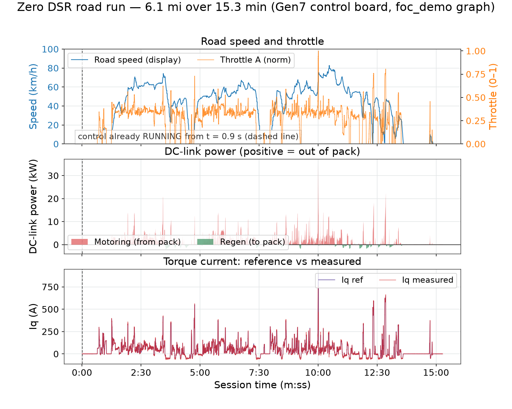
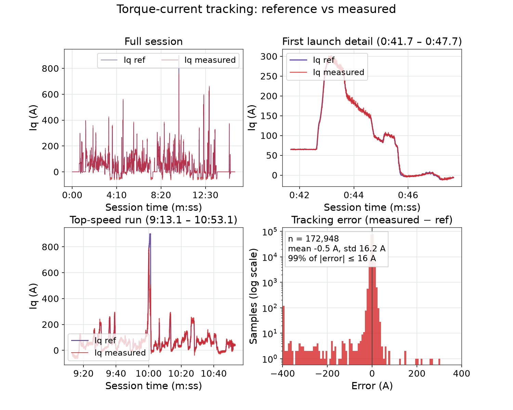
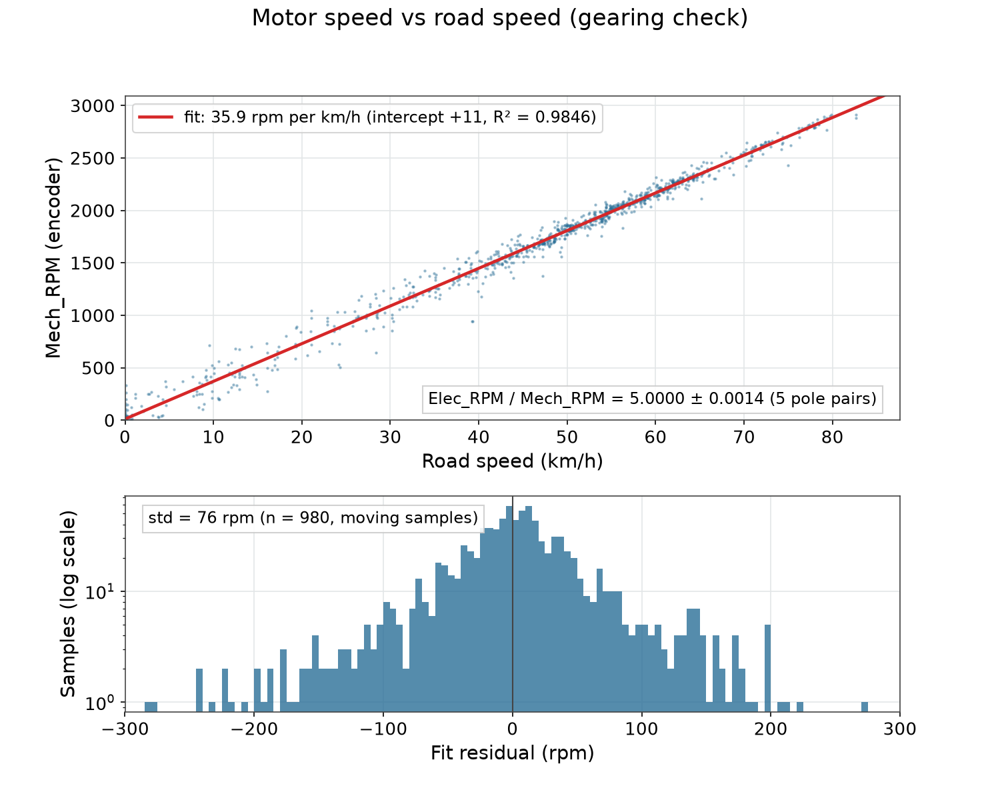
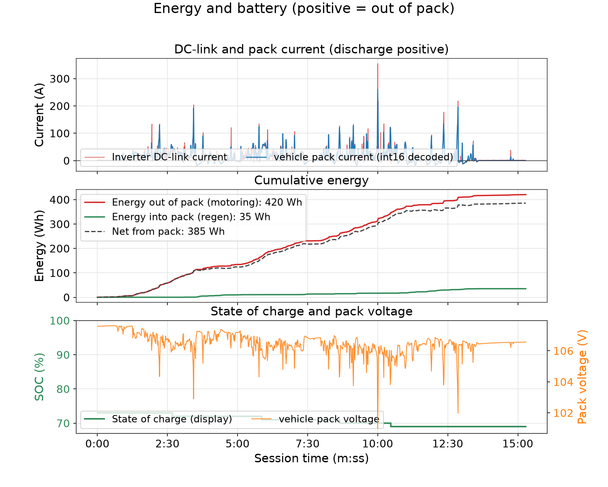
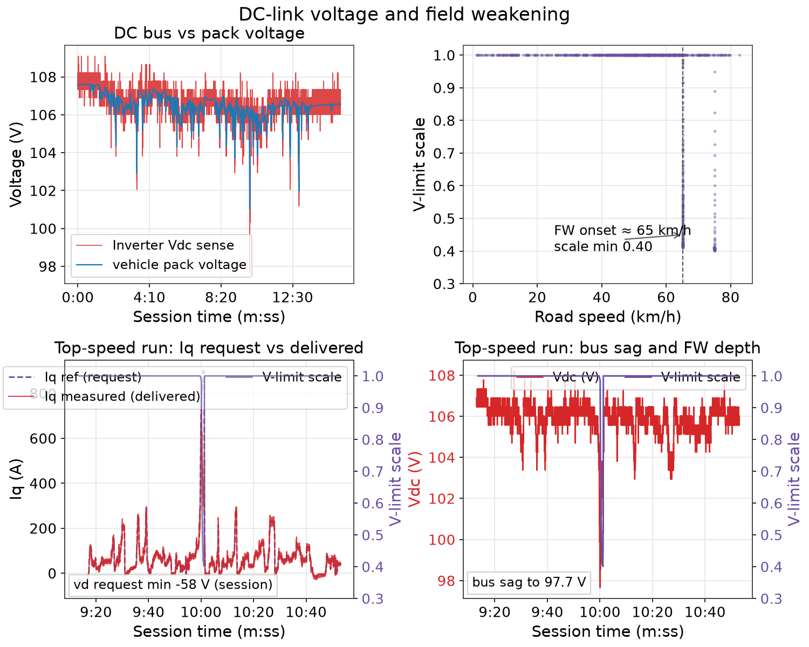
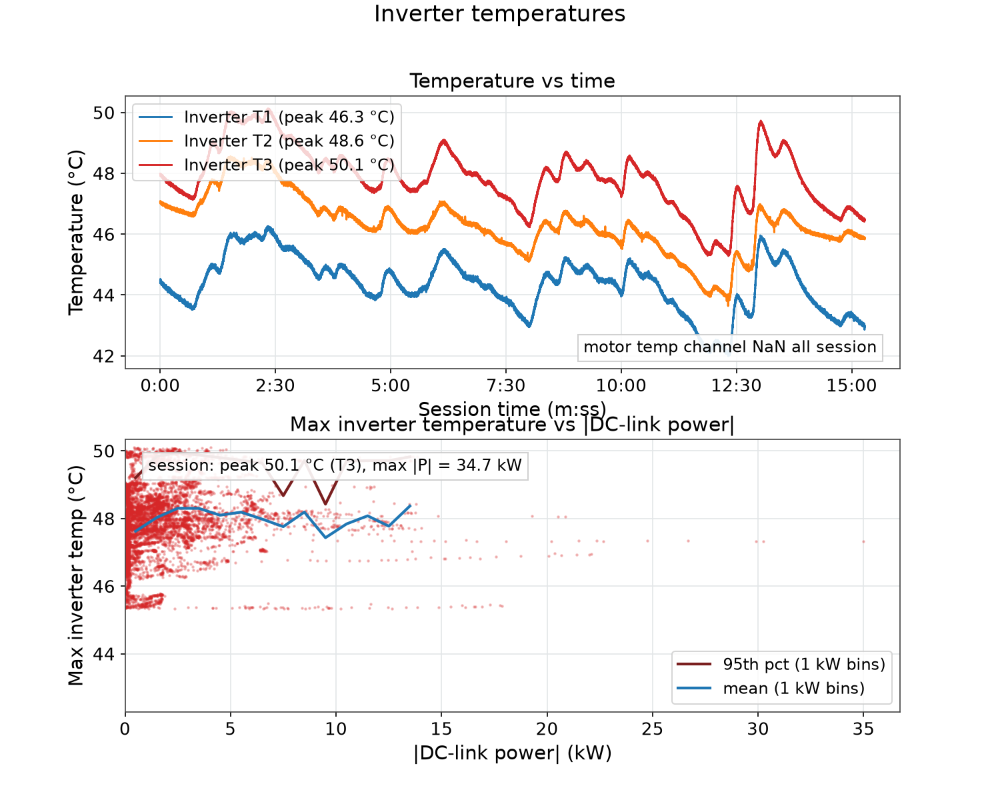

# Zero DSR 2018 Road Test 2 — Sponsor Telemetry Overlay Video

This report covers the second logged road ride of the OpenVVVF Gen7 control board in the Zero DSR (see [test 11, the first road test](../Zero-DSR-Road-Test/Index.md) for the full test-article description). The run's purpose was demonstration rather than bring-up: produce a full-length, sponsor-presentable video that shows the inverter's live telemetry next to the ride footage.

> **Overlay video:** [OpenVVVF Initial Zero Motorcycles DSR Test](https://www.youtube.com/watch?v=oI3p1Wg6aJk) — YouTube, [@OpenVVVF channel](https://www.youtube.com/@OpenVVVF), uploaded 2026-10-16. This is the branded F1-style telemetry overlay rendered from the data analyzed in this report.

The ride itself was a calmer evening run than the first test: 15.3 minutes and 6.1 miles of traffic riding at 24 mph average, topping out at 51.4 mph, with the inverter already warm (44–48 °C) at log start from earlier running the same day. All numbers below are recomputed from the raw session export by `figures.py` in this folder.

## Test article and setup

- **Vehicle / test article:** identical to the first road test — Zero DSR (MY2018), stock Z-Force motor, stock ZF14.4 pack, Gen7 control board.
- **Logging:** RTE Android over USB, protocol TLM1, live mode. Session export `raw/runtime-session-2026-10-17T01-16-37.122Z-1ed2dc74.jsonl.zst` in `Data/Tests/INT-Zero-DSR-Road-Test-2/raw/` (~0.68 GB decompressed, zstd-compressed); 917.05 s, full signal set, no corrupted frames.
- **Video:** helmet camera, 1080p portrait (rotation −90°), 788.1 s, `raw/VID_20261016_181705.mp4` (untracked, ~1.9 GB). Camera clock pinned against the telemetry clock: video starts 30.18 s into the telemetry session (verified at the first-throttle launch, telemetry t ≈ 42.8 s = video ≈ 12.6 s).
- **Overlay production:** `Tools/TelemetryOverlay` (`vvvf-overlay build`), run config `test.overlay.json` (tracked, in the test's `Data/Tests` folder). Source video trimmed to 728.05 s to exclude the arrival segment (address-privacy trim); output is a 737.1 s composite with 5 s branded intro and 4 s sponsor-wall outro.

| Parameter | Value |
|-----------|-------|
| Session start | 2026-10-17 01:16:37 UTC (evening ride, 2026-10-16 local) |
| Duration | 917.05 s (15 min 17 s) |
| Distance (speed integral) | 6.11 mi / 9.8 km |
| Average speed (incl. stops) | 24.0 mph / 38.6 km/h |
| Throttle mapping, full throttle | Iq target 900 A (config `CfgThrMaxA`) |
| Regen cap, zero throttle while rolling | Iq target −50 A (config `CfgThrRegenMaxA`) |
| DC-link current target | 330 A (`cg_dclink_target_a`) |

## Session integrity

The export contains 5.43 M JSONL records across the full 128-signal set with zero corrupted frames. Control was already RUNNING when logging started — `control_state` reports RUNNING from t = 0.9 s for the whole session (the operator started control before hitting record). No faults were latched during the ride.

## Overlay video

The composite render fuses the trimmed helmet video (left, 608 px wide) with two telemetry side panels (60 s trend graphs on the left: speed, power, throttle, torque current, motor rpm; live bars and numeric widgets on the right: speed, motor rpm, throttle, DC power, SOC, DC bus, pack current, phase current, inverter temps), rendered at 15 fps to 1920×1080.

| Overlay statistic | Value |
|-------------------|-------|
| Source video | 788.1 s; last 60 s excluded (privacy trim) → 728.05 s used |
| Telemetry start of video | t = 30.18 s into the session |
| Telemetry end of video | t ≈ 758.2 s (83 % of the 917 s session) |
| Composition | 5 s branded intro + 728.05 s ride + 4 s sponsor outro = 737.1 s total |
| Sponsors shown | Mitsubishi Electric, Mouser, SCS |
| Published | [YouTube video](https://www.youtube.com/watch?v=oI3p1Wg6aJk), 2026-10-16 |

The overlay normalizes the sign conventions: the inverter DC-link power channel is negative while motoring and the vehicle pack telemetry channel reports positive = discharge, so the overlay displays traction power positive and regen negative (median-window filtered, matching the analysis below).

## Ride overview

Normal traffic riding: urban launches with several 40–50 mph road sections and one 82.7 km/h peak at t = 10:28. Top speed was **51.4 mph (82.7 km/h)**; the distance integral gives 6.11 mi at 24.0 mph average. DC-link power is plotted positive when drawn from the pack (motoring) and negative when returned (regen), as in test 11. Small regen sips are visible on deceleration — the vehicle pack channel confirms them (see Power and energy).

## Torque control and current tracking

Tracking is accurate wherever the voltage budget allows it:

| Iq reference band | Samples | Error mean | Error std | Measured / ref |
|-------------------|---------|------------|-----------|----------------|
| 0–50 A | 66k | −0.2 A | 3.4 A | 0.99 |
| 50–200 A | 57k | −0.0 A | 5.9 A | 1.00 |
| 200–500 A | 6.8k | +0.4 A | 11.0 A | 1.00 |
| 500–700 A | 1.0k | −1.4 A | 23.1 A | 1.00 |
| 700–850 A | 118 | −209 A | 149 A | 0.74 |
| 850–950 A | 108 | −550 A | 50 A | 0.38 |

Below 700 A the loop tracks essentially exactly (worst band: ratio 1.00, std ≤ 23 A on transients). The few samples above 700 A occur near the 82.7 km/h top-speed pull, where the voltage-limit scale is down at 0.40 (see below) and the 900 A request is physically undeliverable — same voltage-limiting mechanism documented in test 11. Torque current peaks at **753 A** (19-sample median; 792 A raw) on the hardest launches.

## Speed and motor speed

On this shorter, independent dataset the gearing fit lands at **35.9 rpm per km/h** (intercept +11 rpm, R² = 0.985) — consistent with the 35.4 rpm/km/h from test 11. `Elec_RPM / Mech_RPM` is 5.0000 (σ = 0.0014), again confirming the 5-pole-pair motor. Motor speed peaked at **2993 rpm** on the display channel (2916 rpm by the encoder estimate) during the top-speed pull.

## Power and energy

| Metric | Value |
|--------|-------|
| Peak pack power (vehicle pack telemetry, 1 Hz) | **26.4 kW** (261 A × 106.0 V) |
| Peak DC-link power (inverter channel, median) | 34.7 kW |
| Peak motoring power (2 s average) | 19.0 kW |
| DC-link current peak / 2 s average | 357 A / 187 A (of the 330 A target) |
| Energy out of pack (motoring) | 420 Wh |
| Energy into pack (regen) | 35 Wh (2.2 kW median peak on sips) |
| Net from pack | 385 Wh |
| Consumption | 63 Wh/mi (39 Wh/km) — vs 91 Wh/mi on test 11 |
| State of charge | 73 % → 69 % |
| Vehicle pack voltage | 107.6 V → 106.6 V (min 101.0 V) |

The 1 Hz pack channel undersamples the fast peaks exactly as in test 11 (26.4 kW vs 34.7 kW at the same event), and it correlates 0.993 with the inverter channel after wrap-decoding. Regen is small on this ride but real: the wrap-decoded pack channel goes down to −20 A (137 negative samples, at 16–47 mph) and the DC-link channel shows −2.2 kW median sips.

## Voltage and field weakening

At the lower 73 % SOC the bus lives near 106–108 V; the inverter sense spans 97.7–109.1 V. Field weakening engages above roughly 65 km/h — the voltage-limit scale dips to **0.40** on the 80–83 km/h pull with `vd` request down to −58 V — even on this undemanding ride, consistent with the deeper 0.38 dips at 96 km/h in test 11. During the top-speed window the bus sags to 97.7 V.

## Thermals

| Sensor | Start | Peak | End |
|--------|-------|------|-----|
| Inverter T1 | 44.4 °C | 46.3 °C | 43.0 °C |
| Inverter T2 | 47.1 °C | 48.6 °C | 45.9 °C |
| Inverter T3 | 48.0 °C | 50.1 °C | 46.5 °C |
| Motor | — | invalid (NaN) all session | — |

The inverter entered the log already warm from earlier running that day (44–48 °C at t = 0) and stayed in a **44–50 °C band** — the small ride adds almost nothing thermally; temperatures decline slightly by the end as speed drops. The motor temperature channel again reported NaN for the entire session.

## Findings and follow-ups

1. **Regen happens; the previous "no regen" note is wrong.** The vehicle pack telemetry channel is wrapping unsigned 16-bit; decoded signed values reach −20 A during deceleration (137 samples), and the DC-link power channel shows median sips to −2.2 kW, totaling 35 Wh returned. The overlay hid these events because its validity filter (`v < 1000`) discards both the 65535 sentinel and wrapped-negative values, and its power graph floor makes the small sips easy to miss. If regen should be visible in future sponsor renders, decode the wrapping channel instead of thresholding it.
2. **Single-sample glitches sit on the phase current channels, not the DC link.** Raw phase currents (`cg_iu/iv/iw`) spike to ±814 A against a 506 A 19-sample-median peak; the overlay's median filtering handles it. The DC-link current itself is clean in this session (357 A maximum; never more than ~26 A off its median window). The earlier note attributing ±800 A glitches to the DC link is corrected accordingly.
3. **Clock alignment.** The video/telemetry offset (30.18 s) relies on the camera clock and a clip reference (launch at telemetry ≈42.8 s = video ≈12.6 s). Consider a spoken "mark" frame at session start so alignment is self-documenting for future rides.
4. **Telemetry coverage vs video.** The public overlay covers telemetry to t ≈ 758 s; the final ~159 s of the log (arrival segment) is analyzed here but intentionally not in the video.
5. **Pack telemetry encoding.** As on test 11, the wrapping unsigned pack-current channel needs decoding plus sentinel rejection (30 of 916 samples carried the 65535 sentinel here); raw values must not be quoted directly.

## Artifacts

| Artifact | Path |
|----------|------|
| Brand overlay video (sponsor render) | `Data/Tests/INT-Zero-DSR-Road-Test-2/video/gen7_ride_branded.mp4` (untracked); published at [youtube.com/watch?v=oI3p1Wg6aJk](https://www.youtube.com/watch?v=oI3p1Wg6aJk) |
| Overlay run config | `Data/Tests/INT-Zero-DSR-Road-Test-2/test.overlay.json` (tracked) |
| Raw telemetry session | `Data/Tests/INT-Zero-DSR-Road-Test-2/raw/runtime-session-2026-10-17T01-16-37.122Z-1ed2dc74.jsonl.zst` |
| Source helmet video | `Data/Tests/INT-Zero-DSR-Road-Test-2/raw/VID_20261016_181705.mp4` (untracked) |
| Analysis script (this report) | `figures.py` in this folder — streams the zstd-compressed raw log, recomputes every number quoted above, and renders fig-01…fig-06 |
| Figures | `fig-01-ride-overview.png` … `fig-06-thermal.png` in this folder |
