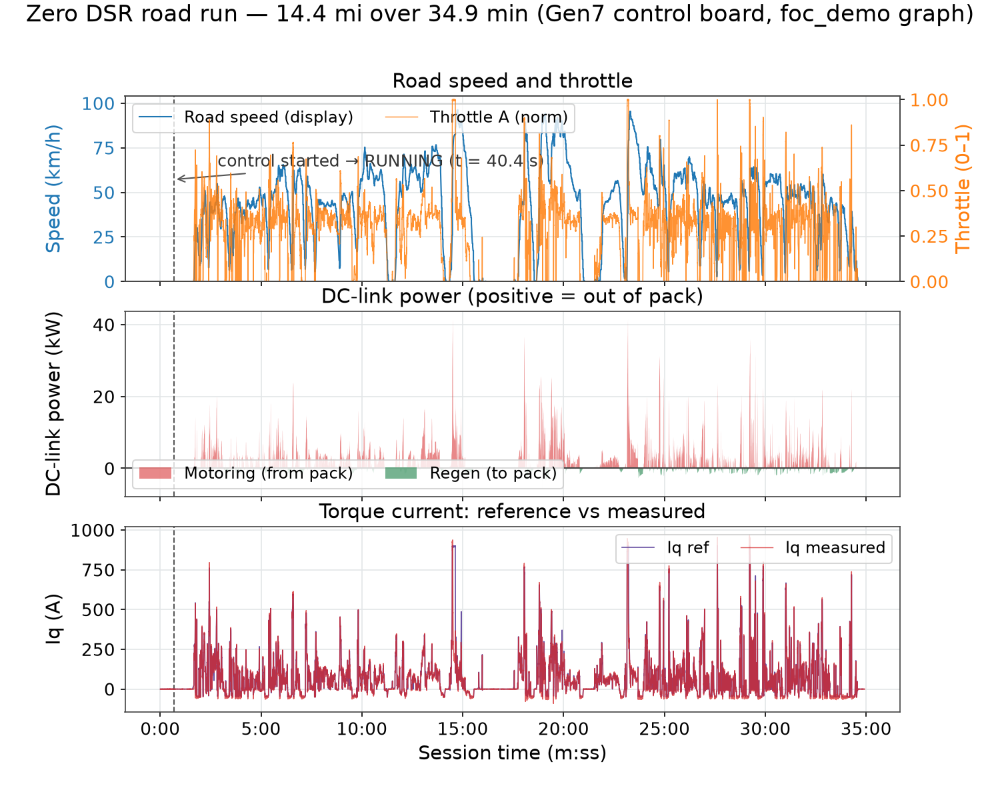
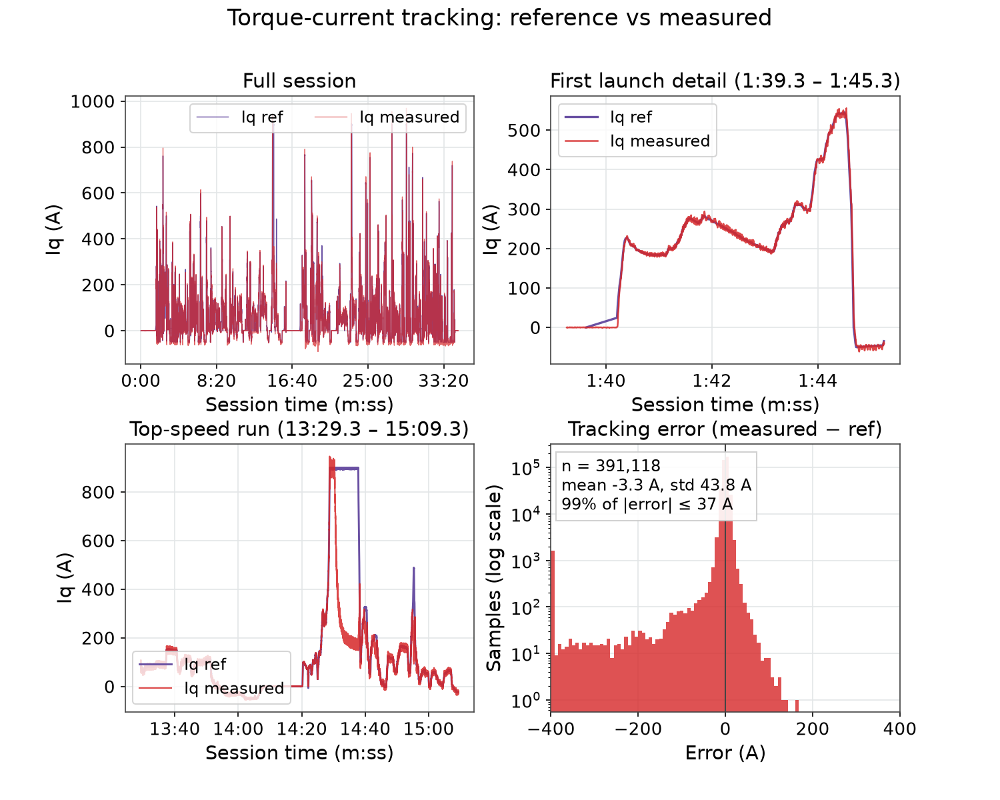
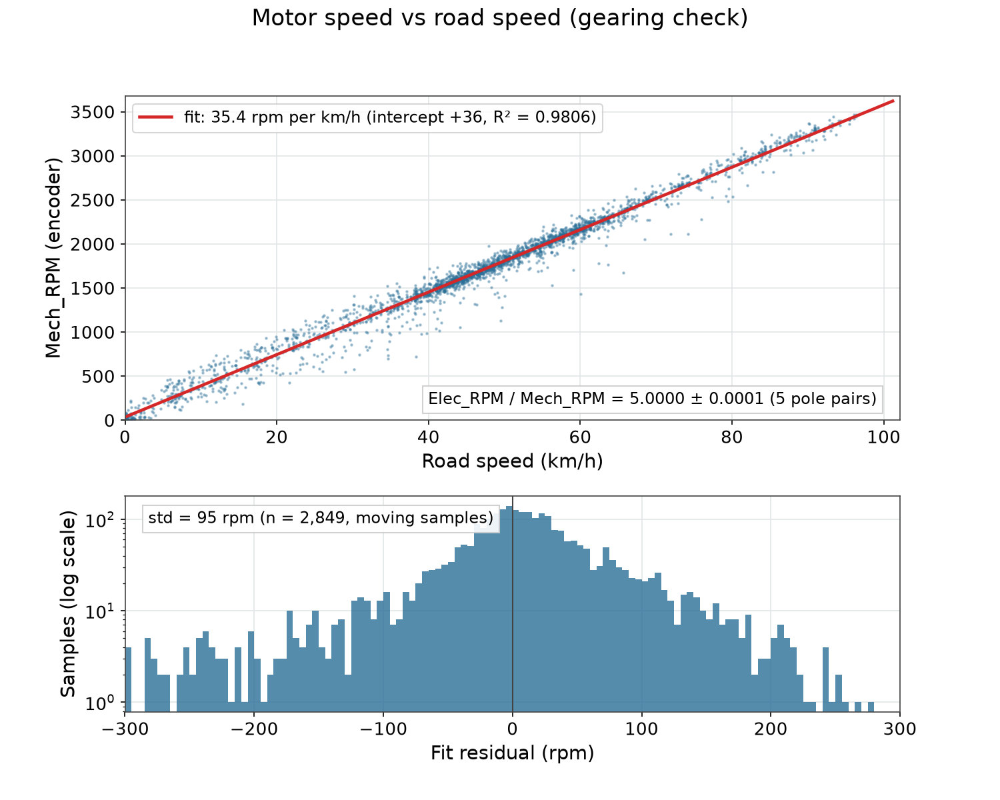
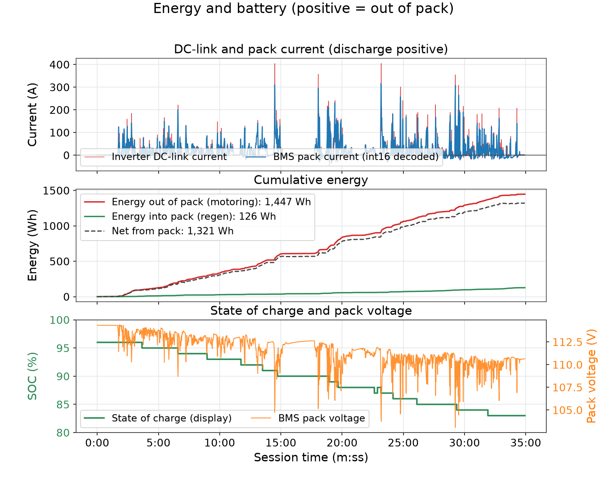
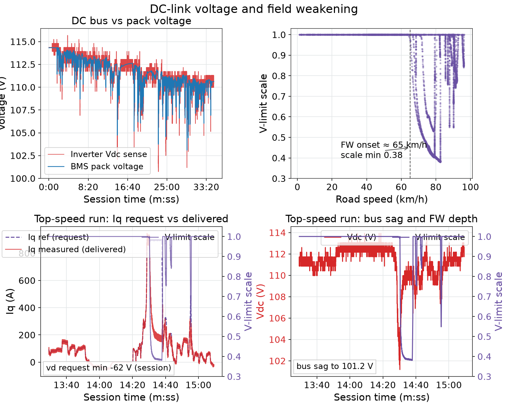
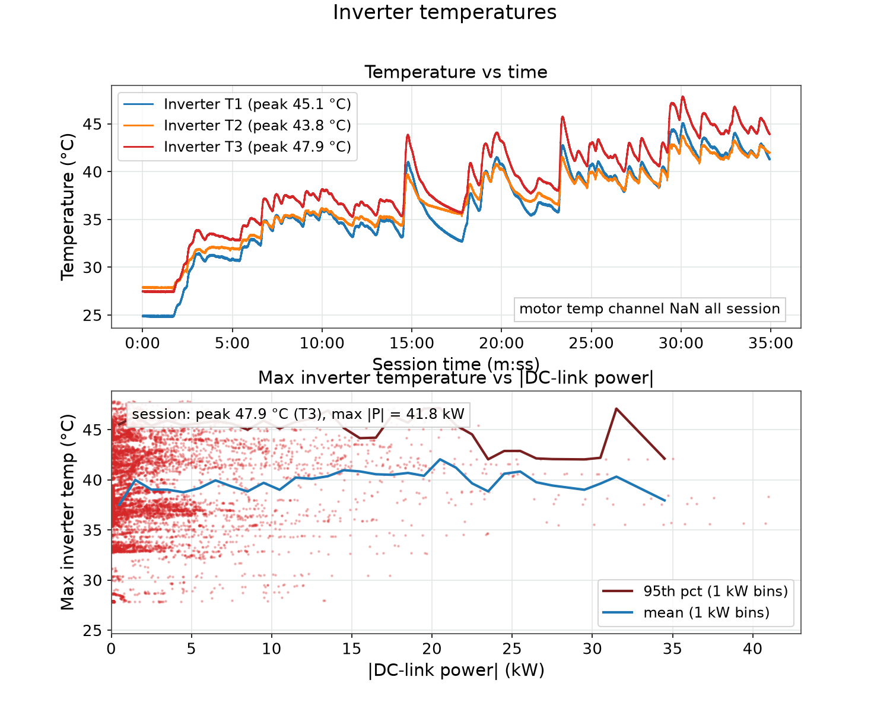

# Zero DSR 2018 Road Test — First Vehicle Telemetry

This report is the first logged telemetry from the OpenVVVF Gen7 control board installed in a road vehicle: a Zero Motorcycles DSR (model year 2018) riding on public roads. The inverter drove the stock Z-Force motor from the stock pack, with the stock display retained and integrated. The run was logged live from an Android host over USB — 34.9 minutes and 14.4 miles of real traffic riding in one continuous session, with zero faults and zero corrupted frames.

The purpose of the run was bring-up and observation, not a formal pass/fail campaign: confirm that throttle, current control, and the vehicle display all behave under real riding, and capture the first drive-cycle dataset for analysis.

## Test article and setup

- **Vehicle:** Zero Motorcycles DSR (MY2018), stock Z-Force 75-7R radial-flux IPM motor (5 pole pairs — confirmed from telemetry), stock ZF14.4 pack, stock dash/display. Per published specs the stock controller is rated 775 A with a 14.4 kWh maximum / 12.6 kWh nominal pack ([Motorcycle.com first-ride specifications](https://www.motorcycle.com/manufacturer/zero/2018-zero-dsr-first-ride-review.html)).
- **Inverter:** OpenVVVF Gen7 control board ("Control Board Gen 7"), driving the motor in place of the stock controller.
- **Firmware:** `foc_demo` RTE graph (hash `bb9f1bd89c82c181`), started with `control start` — the main RTE graph motor control path. Switching 2.5 kHz, control update 5 kHz.
- **Logging:** RTE Android app over USB (`/dev/bus/usb/002/003`), protocol TLM1, live mode. Session export: 12.14M numeric samples across 128 declared signals.
- **Ride:** public roads, mixed stop-and-go and open-road riding, ambient in the mid-20s °C.

| Parameter | Value |
|-----------|-------|
| Session start | 2026-10-16 10:35:13 UTC |
| Duration | 2095.9 s (34 min 56 s) |
| Distance (speed integral) | 14.4 mi / 23.2 km |
| Average speed (incl. stops) | 24.8 mph / 40 km/h |
| Throttle mapping, full throttle | Iq target 900 A (config `CfgThrMaxA`) |
| Regen cap, zero throttle while rolling | Iq target −50 A (config `CfgThrRegenMaxA`) |
| DC-link current target | 330 A (`cg_dclink_target_a`) |
| Throttle channels | A enabled, B disabled |

## Session integrity

| Metric | Value |
|--------|-------|
| Good frames | 420,076 |
| Bad frames (CRC / header / length / parse / unknown ID) | 0 / 0 / 0 / 0 / 0 |
| Frame rate | 203 Hz (47.2 kB/s) |
| Current-frame sample age | 22.9 µs mean |
| Shell UART errors / dropped RX | 0 / 0 |
| Coprocessor safety state | ARMED for the whole session |
| Fault flags (main and coprocessor) | `0x00000000`, names `none`, all session |

`control start` was issued once at t = 40.2 s. `control_state` went IDLE → RUNNING at t = 40.4 s and stayed RUNNING until the log ended. Gate power was ready the whole run; `gate_reset_asserted` appears only before the start (t = 0.5–39.5 s, while armed) and never again.

## Ride overview

The riding pattern is ordinary traffic use: repeated launches from standstill, cruise in the 40–70 km/h band, and several open-road pulls to the 90–96 km/h region. Top speed in this run was **59.9 mph (96.4 km/h)** at t = 14:44. DC-link power is plotted positive during acceleration (drawn from the pack) and negative when slowing (returned as regen) — the sign convention used throughout this report; the raw inverter channel reports the opposite sign. Torque current follows the throttle pedal closely and spikes to 500–900 A on each hard launch.

## Torque control and current tracking

The throttle blend maps channel A directly to an Iq target: full throttle requests 900 A, zero throttle while rolling requests −50 A (regen), and a neutral band blends between the two at low speed.

Tracking is tight wherever the voltage limit allows the current to be delivered:

| Iq reference band | Samples | Error mean | Error std | Measured / ref |
|-------------------|---------|------------|-----------|----------------|
| 0–50 A | 108k | −0.2 A | 4.2 A | 0.99 |
| 50–200 A | 129k | −0.0 A | 7.6 A | 1.00 |
| 200–500 A | 33k | −3.5 A | 24.3 A | 0.99 |
| 500–700 A | 3.5k | −9.8 A | 56.5 A | 0.98 |
| 700–850 A | 1.1k | −62 A | 144 A | 0.92 |
| 850–950 A | 3.1k | −344 A | 325 A | 0.62 |

The shortfall at high reference is not a current-loop problem — it is voltage limiting. At low speed the 900 A request is tracked exactly (measured 893.9 A vs 893.1 A referenced, v-limit scale ≈ 1.0, ~35 km/h); at highway speed with the v-limit scale at 0.38–0.6 the same request only produces ~258 A average (measured) at ~80 km/h. The reference is not derated for voltage feasibility, so it saturates at 900 A while the physics delivers less. Regen tracks the −50 A cap cleanly (measured mean −49.4 A).

## Speed and motor speed

Encoder-derived motor speed and the vehicle display speed are consistent throughout: **35.4 rpm per km/h** (≈57 rpm per mph) by linear fit (intercept +36 rpm, R² = 0.98), i.e. roughly 3450 rpm at the 96.4 km/h peak. `Elec_RPM / Mech_RPM` is 5.0000 with σ = 0.0001, confirming the 5-pole-pair motor configuration. The display motor-RPM channel agrees in magnitude with the encoder estimate (peak 3488 vs 3470 rpm).

## Power and energy

| Metric | Value |
|--------|-------|
| Peak motoring power (instantaneous) | 41.8 kW (406 A at ~102 V) |
| Peak motoring power (2 s average) | 34.1 kW ≈ 328 A — at the 330 A DC-link target |
| Peak regen power (instantaneous / 2 s average) | 5.6 kW / 3.2 kW — at the 50 A regen cap |
| Energy out of pack (motoring) | 1447 Wh |
| Energy into pack (regen) | 126 Wh (8.7 % of motoring energy returned) |
| Net from pack | 1321 Wh |
| Consumption | 91 Wh/mi (57 Wh/km) over the ride |
| State of charge | 96 % → 83 % |
| Pack voltage | 114.3 V → 110.6 V (inverter Vdc sense 100.3–115.7 V) |

The DC-link current never flags the configured 330 A limiter as active, but the 2 s rolling average lands right at 328 A on the hardest pulls, so the limit is being approached rather than missed. A separate 1 Hz pack-current telemetry channel correlates 0.992 with the inverter DC-link current with the opposite sign convention (positive = discharge); its 1 Hz rate under-samples peaks (316 A on that channel vs 406 A at the inverter).

## Voltage and field weakening

Bus voltage sags from ~114 V at rest to 100.3 V on the hardest acceleration. Field weakening engages above roughly 65 km/h: the voltage-limit scale dips from 1.0 down to **0.38** in the 80–96 km/h band, with `vd` request reaching −62 V. During the top-speed run the bus sags to ~101 V while the v-limit scale bottoms at 0.38 — this is the regime where the 900 A torque request becomes unachievable, as described above.

## Thermals

| Sensor | Start | Peak | End |
|--------|-------|------|-----|
| Inverter T1 | 24.9 °C | 45.1 °C | 41.3 °C |
| Inverter T2 | 27.9 °C | 43.8 °C | 42.0 °C |
| Inverter T3 | 27.5 °C | 47.9 °C | 43.9 °C |
| Motor | — | invalid (NaN) all session | — |

The power stage stayed cool over 35 minutes of real riding — peak under 48 °C, no derating (`vdc_derate_limit_a` = 0 throughout). The motor temperature channel is disabled or unwired on this installation and reported NaN the entire session.

## Vehicle integration status

| Interface | Status over the session |
|-----------|------------------------|
| Display | Connected throughout; speed valid; SOC fresh; 0–17 skipped TX frames (minor) |
| HV pack | Contactor closed, output enabled, power ready, interlock ready — constant |
| Precharge | `output_enabled` from t = 0.6 s |
| Charger | Idle/disconnected (as expected for a ride) |
| Gate driver | Ready = 1, fault = 0 all session; reset asserted only before control start |
| Faults | None latched, none active, no safety coprocessor faults |

## Observations and follow-ups

1. **Torque ceiling vs stock hardware.** `CfgThrMaxA` is set to 900 A, above the stock Zero controller's 775 A rating. Decide deliberately what the ceiling should be and document it; at speed the request is unreachable anyway (item 2).
2. **Voltage-feasible current.** The Iq reference saturates at 900 A without derating for voltage feasibility, so the logged error at high speed is expected. A feedforward/ref-shaping step (the graph already carries `FocFeedforward`) would make the request match what the bus can deliver.
3. **DC-link limiter.** The 330 A target is approached (328 A over 2 s) but `cg_dclink_limit_active` never asserts; verify limiter bandwidth and threshold on a sustained pull.
4. **Current-sense headroom.** Raw phase currents reach ±970 A and measured Iq occasionally overshoots the reference by up to 161 A on transients — near the sensor range end. Validate scaling/ADC headroom before higher-power runs.
5. **Motor temperature.** `temp_motor_c` is NaN for the entire session (sensor disabled/unwired). Wire it up or disable the channel cleanly so future logs are unambiguous.
6. **Pack-current encoding.** The vehicle's 1 Hz pack-current telemetry channel is published as a wrapping unsigned value; the derived signed values are used throughout the energy analysis (see `telemetry-decimated.csv`, which stores the decoded value).

## Data artifacts

- `telemetry-decimated.csv` — 2 Hz, 20-channel extract of the session (speed, RPM, Iq/Id, voltages, currents, power, throttle, SOC, temperatures, v-limit scale) for re-plotting.
- `fig-01` … `fig-06` — the figures in this report, generated from the full-rate session data by `figures.py` in this folder (streams the zstd-compressed raw log and recomputes every number quoted above).
- Source log: RTE runtime session export `runtime-session-2026-10-16T10-35-13.517Z-11b27791.jsonl` (12.14M samples, ~1.5 GB), zstd-compressed in [`Data/Tests/INT-Zero-DSR-Road-Test/raw/`](../../../../Data/Tests/INT-Zero-DSR-Road-Test/raw/); opens in the [telemetry viewer](../../../Tools/OpenVVVF-Telemetry-Viewer/Index.md) directly from the compressed file.
